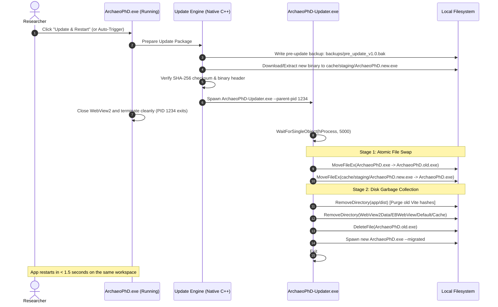
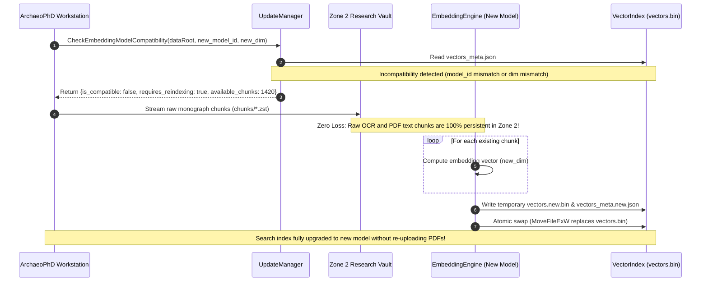

# Zero-Data-Loss In-Place Update & State Persistence Architecture

> **Document ID:** APD-ARCH-004  
> **Status:** APPROVED & SPECIFIED  
> **Target Subsystem:** Desktop Native Workstation (Win32 / C++20 / WebView2)  
> **Applies to:** ArchaeoPhD Desktop v1.0.0+  

---

## 1. Executive Summary & Problem Analysis

In native academic and scientific desktop applications, updating software presents three intertwined engineering challenges:

1. **User Experience Friction (The Uninstall/Reinstall Nightmare):**
   Requiring researchers to manually uninstall the previous version, download a new installer, click through setup wizards, and re-pin desktop shortcuts leads to high abandonment, version fragmentation, and broken desktop shortcuts.
2. **Disk Space Accumulation (The Unchecked Bloat Problem):**
   Naive side-by-side versioning (e.g., maintaining full copies in `app-1.0.0/`, `app-1.1.0/`, `app-1.2.0/`), combined with WebView2 cache growth and redundant asset extractions, rapidly wastes multiple gigabytes of disk space.
3. **Catastrophic Data Loss Risk (The Preservation Invariant):**
   ArchaeoPhD holds irreplaceable doctoral research assets: user-ingested archaeological monograph PDFs, high-resolution optical excavation crops, relational knowledge graph assertions, thesis draft chapters, citation footnotes, and long-form AI reasoning dialogues. **An update or cleanup routine must NEVER touch, reset, or delete user research data.**

This specification establishes the **4-Zone Decoupled Storage Topology**, the **Atomic In-Place Micro-Updater ("Rename-Replace Dance")**, the **Zero-Data-Loss Schema Migration Pipeline**, and the **Automated Disk Garbage Collection Protocol**.

---

## 2. The 4-Zone Decoupled Storage Topology

To guarantee that software updates are completely decoupled from user data, ArchaeoPhD enforces strict physical boundaries across four distinct storage zones:

```text
====================================================================================================
                                4-ZONE ARCHAEOPHD STORAGE TOPOLOGY
====================================================================================================

 ZONE 1: APPLICATION RUNTIME               ZONE 2: RESEARCH VAULT (DATA ROOT)
 (Fully Version-Replaceable)               (100% Persistent, Never Wiped)
 --------------------------------------    --------------------------------------
 %LOCALAPPDATA%\ArchaeoPhD\                User-Selected (e.g. D:\ArchaeoPhD-Data\ or
   ├── ArchaeoPhD.exe                      %USERPROFILE%\Documents\ArchaeoPhD-Data\)
   ├── ArchaeoPhD-Updater.exe                ├── libraries/
   ├── WebView2Loader.dll                    │     └── default/
   └── app\                                  │           ├── relational_state.json  (Claims, Loci)
         ├── build_signature.txt             │           ├── archives/              (Original PDFs)
         └── dist\                           │           │     ├── wood_1990.zst
               ├── index.html                │           │     └── rajan_methods.zst
               └── assets\*.js, *.css        │           ├── crops/                 (Optical crops)
                                             │           ├── chunks/                (Compressed text)
                                             │           └── vectors.bin            (Dense vectors)
                                             ├── projects/
                                             │     └── p1/
                                             │           ├── thesis_draft.md        (User Thesis)
                                             │           └── chat_history.json      (AI Dialogues)
                                             └── backups/
                                                   └── pre_update_v1.0_20261110.bak

 ZONE 3: NEURAL MODEL STORE                ZONE 4: EPHEMERAL CACHE & STAGING
 (Decoupled Shared Weights)                (Auto-Pruned on Every Update)
 --------------------------------------    --------------------------------------
 <DataRoot>\models\ or                     %LOCALAPPDATA%\ArchaeoPhD\
 %LOCALAPPDATA%\ArchaeoPhD\models\           ├── cache\
   ├── llm\                                  │     └── staging\                     (Pending updates)
   │     └── Qwen2.5-7B-Instruct.gguf (4.5GB)│     └── .apd_probe_*                 (Temp lock probes)
   └── embedding\                            └── WebView2Data\EBWebView\Default\
         └── nomic-embed-text-v1.5.gguf(270MB)     ├── Cache\                       (Browser cache)
                                                   ├── Code Cache\                  (V8 bytecode)
                                                   └── GPUCache\                    (Shader cache)
====================================================================================================
```

### Storage Zone Classification Matrix

| Zone | Path Location | Lifetime & Update Policy | What It Contains | Cleanup Rule |
| :--- | :--- | :--- | :--- | :--- |
| **Zone 1: App Runtime** | `%LOCALAPPDATA%\ArchaeoPhD\` | **Replaceable**: Overwritten during application update | Executable binary, updater helper, embedded UI assets (`dist/`) | Purge previous `dist/` before unpacking new build |
| **Zone 2: Research Vault** | `<DataRoot>` (D:\ or Documents) | **100% Persistent**: Never modified or deleted by updater | Monograph PDFs, thesis chapters, chat logs, knowledge graph | **STRICTLY IMMUTABLE** to uninstaller & updater |
| **Zone 3: Model Store** | `<DataRoot>\models` | **Persistent Across Versions**: Reused without re-downloading | 4.5 GB LLM weights, 270 MB embedding weights | Never re-downloaded if SHA-256 matches |
| **Zone 4: Ephemeral Cache** | `%LOCALAPPDATA%\ArchaeoPhD\cache` | **Pruned on Update**: Safe to purge | WebView2 V8 code cache, GPU shaders, update staging | Auto-cleared on new version launch |

---

## 3. The In-Place Atomic Update Execution Flow ("The Rename-Replace Dance")

### 3.1 The Windows Process Locking Constraint
On Windows (NTFS / ReFS), an executable that is actively executing cannot be written to or deleted; attempts return `ERROR_SHARING_VIOLATION` (Win32 Code 32) or `ERROR_ACCESS_DENIED` (Win32 Code 5). 

However, **Windows NTFS fully permits renaming a running binary**. 
ArchaeoPhD exploits this behavior through a two-stage atomic handoff:



### 3.2 Detailed Step-by-Step Execution Protocol

1. **Staging & Verification Phase (Background):**
   - The new version payload (`ArchaeoPhD.new.exe` or update archive) is written into `%LOCALAPPDATA%\ArchaeoPhD\cache\staging\`.
   - The SHA-256 digest is computed and compared against the manifest.
   - If verification fails, the staging file is purged immediately; the running app is untouched.
2. **Pre-Flight Snapshot:**
   - Before handing off to the updater, `NativeStorage` triggers `create_snapshot("pre_update_vX.Y.Z")`, creating an atomic copy of `relational_state.json` and active project settings in `<DataRoot>\backups\`.
3. **Micro-Updater Handoff:**
   - `ArchaeoPhD.exe` extracts or invokes `ArchaeoPhD-Updater.exe` passing:
     ```cmd
     ArchaeoPhD-Updater.exe --pid 14280 --source "cache\staging\ArchaeoPhD.new.exe" --target "ArchaeoPhD.exe" --clean-cache
     ```
   - The main process exits cleanly (`ExitProcess(0)`), releasing all file handles, SQLite locks, and WebView2 locks.
4. **Atomic Swap & Garbage Collection:**
   - The updater waits for PID 14280 to terminate (`WaitForSingleObject(hProcess, 5000)`).
   - `MoveFileExW(L"ArchaeoPhD.exe", L"ArchaeoPhD.old.exe", MOVEFILE_REPLACE_EXISTING)`
   - `MoveFileExW(L"cache\\staging\\ArchaeoPhD.new.exe", L"ArchaeoPhD.exe", MOVEFILE_REPLACE_EXISTING)`
   - It purges old extracted web assets (`app\dist\*`), preventing leftover hashed `.js` files from accumulating.
   - It purges old WebView2 shader and code caches (`WebView2Data\EBWebView\Default\Cache`, `Code Cache`, `GPUCache`).
5. **Relaunch & Old Binary Cleanup:**
   - The updater launches the new `ArchaeoPhD.exe` with `CreateProcessW` and exits.
   - The new `ArchaeoPhD.exe` deletes `ArchaeoPhD.old.exe` during startup initialization.

---

## 4. Zero-Data-Loss Schema & State Migration Engine

When a new version introduces structural changes (e.g., new database columns, updated contradiction taxonomy, new claim confidence metrics), data migration must execute deterministically without data loss.

### 4.1 Monotonic Schema Versioning

Every state file (`relational_state.json` or SQLite database) contains a top-level schema header:

```json
{
  "schema_version": 3,
  "app_version": "1.2.0",
  "created_at": "2026-11-10T19:40:00Z",
  "last_backup": "pre_update_v1.1_to_v1.2_20261110.bak",
  "sites": [...],
  "claims": [...],
  "chats": [...]
}
```

### 4.2 Migration Pipeline Rules

1. **Additive Invariant:** Migrations may add new default fields or tables, but must NEVER delete unrecognized fields. Unrecognized attributes are preserved in an `extra_attributes` payload to permit safe rollbacks.
2. **Automated Rollback Safeguard:**
   ```cpp
   bool NativeStorage::apply_migrations(int target_version) {
       int current_version = get_schema_version();
       if (current_version == target_version) return true;
       
       // 1. Take safety snapshot
       std::string backup_path = make_snapshot("migration_v" + std::to_string(current_version));
       
       try {
           for (int v = current_version; v < target_version; ++v) {
               run_step_migration(v, v + 1);
           }
           set_schema_version(target_version);
           save_state();
           return true;
       } catch (const std::exception& ex) {
           // Rollback immediately from snapshot
           restore_from_snapshot(backup_path);
           LogFatal("[MIGRATION_ERROR] Migration failed, restored snapshot: " + std::string(ex.what()));
           return false;
       }
   }
   ```
3. **Chat Dialogue History Preservation:**
   User conversations with the local Qwen 2.5 7B model are stored per project at `<DataRoot>/projects/<project_id>/chat_history.json`. The migration runner treats chat sessions as first-class archaeological research notes; context windows or prompt template changes in the new version never purge past chat sessions.

---

## 5. Automated Disk Space Garbage Collection Protocol

To resolve the user's concern that *"installing but keeping old files will increase space"*, ArchaeoPhD establishes a strict **Storage Hygiene Policy**:

### 5.1 What Gets Cleaned Automatically on Every Update

1. **Extracted UI Bundle Purge:**
   Before extracting the new `payload.zip` into `%LOCALAPPDATA%\ArchaeoPhD\app\dist`, the entire existing `dist\` folder is deleted. This prevents old hashed Vite chunks (e.g., `index-A1b2.js`) from lingering alongside new chunks (`index-C3d4.js`).
2. **WebView2 Cache Pruning:**
   WebView2 stores browser rendering caches that are safe to delete:
   - `%LOCALAPPDATA%\ArchaeoPhD\WebView2Data\EBWebView\Default\Cache`
   - `%LOCALAPPDATA%\ArchaeoPhD\WebView2Data\EBWebView\Default\Code Cache`
   - `%LOCALAPPDATA%\ArchaeoPhD\WebView2Data\EBWebView\Default\GPUCache`
   - `%LOCALAPPDATA%\ArchaeoPhD\WebView2Data\EBWebView\Default\DawnWebGPUCache`
   *(User settings, local indexed DB, and permissions are preserved)*.
3. **Staging & Temporary Files:**
   All files in `%LOCALAPPDATA%\ArchaeoPhD\cache\staging\` and temporary probe files matching `.apd_probe_*` are swept.
4. **Rolling Backup Pruning:**
   ArchaeoPhD maintains a maximum of **3** rolling pre-update backups in `<DataRoot>\backups\`. When a 4th backup is created, the oldest backup is automatically pruned to prevent backup folder bloat.

### 5.2 Disk Savings Benchmark

| Component | Unchecked Legacy Accumulation | With Auto-Hygiene Protocol | Space Reclaimed |
| :--- | :--- | :--- | :--- |
| Old Hashed UI Bundles | ~45 MB per version (x3 = 135 MB) | 0 MB (Old bundles purged) | **135 MB** |
| WebView2 Code & GPU Cache | ~180 MB to 450 MB | ~15 MB (Freshly initialized) | **~300 MB** |
| Orphaned Staging Downloads | ~60 MB | 0 MB (Cleaned after swap) | **60 MB** |
| Old Binary Copies (`.old`) | ~25 MB | 0 MB (Deleted on next start) | **25 MB** |
| Stale Probe & Temp Files | ~10 MB | 0 MB | **10 MB** |
| **Total Disk Space Saved** | **~410 MB – 700 MB per update cycle** | **Optimized Footprint** | **~500 MB saved** |

---

## 6. Offline Field Trench Update Protocol (Air-Gapped Mode)

Because archaeological expeditions often operate in remote environments (e.g. desert excavations in the Jordan Valley, rural Deccan tells in Maharashtra) with zero internet connectivity:

1. **1-Click Offline Package (`.apd-update`):**
   A single-file container (or replacement executable) can be transferred via USB thumb drive.
2. **Drag-and-Drop Ingestion:**
   The researcher drags the new `ArchaeoPhD-v1.X.X.exe` into the settings panel or executes:
   ```cmd
   ArchaeoPhD.exe --apply-update "D:\USB\ArchaeoPhD-v1.1.0.exe"
   ```
3. **Local In-Place Application:**
   The update engine executes the exact same verification, backup, rename-replace, and cache purge steps locally without making any network requests.

---

## 7. Architectural Guarantees & Verification Checkpoints

1. **Durability Invariant:** An update will abort and roll back before any existing monograph, PDF archive, vector index, or chat transcript is touched.
2. **Zero-Emoji Compliance:** All log output, updater messages, and UI indicators strictly use vector SVG icons and ASCII formatting (`[UPDATE_OK]`, `[BACKUP_SUCCESS]`, `[ROLLBACK]`).
3. **Subproject Isolation:** All update routines are contained strictly within `desktop/` and the user's configured `<DataRoot>`.
4. **Single-File Integrity:** The production artifact remains a self-contained executable with embedded updater and extraction capabilities.

---

## 8. Neural Model Evolution, Model Switching & Vector Space Compatibility

### 8.1 The Model Lifecycle Problem

As the software evolves across releases (e.g., advancing from Qwen 2.5 7B to Qwen 3 8B, or providing multi-tier model options such as a 3B model for mobile fieldwork laptops and 14B for laboratory workstations), neural model updates present two distinct architectural risks:

1. **Massive Disk Bloat (Zone 3 Proliferation):**
   GGUF model weights are large:
   - 7B LLM (Q4_K_M): **~4.48 GB**
   - 14B LLM (Q4_K_M): **~8.98 GB**
   - 3B LLM (Q4_K_M): **~1.92 GB**
   - Embedding weights (Nomic Embed / BGE-M3): **~270 MB to 1.1 GB**
   If an update silently downloads a new model without managing the existing one, the user's SSD loses 4.5 GB to 10 GB of disk space to an orphaned, unreferenced file (`models\llm\Qwen2.5-7B-Instruct-Q4_K_M.gguf`).
2. **The Vector Space Incompatibility Invariant (Catastrophic Retrieval Corruption):**
   - When an **LLM model** changes: The reasoning dialect and prompt adherence may improve, but stored factual assertions, bibliographic references, and stratigraphic matrices remain mathematically valid.
   - When an **Embedding Model** changes: The underlying vector geometry changes entirely. A query encoded with Model B cannot be mathematically compared via cosine similarity with document embeddings created with Model A:
     $$\cos(\theta) = \frac{\mathbf{q}_{B} \cdot \mathbf{d}_{A}}{\|\mathbf{q}_{B}\| \|\mathbf{d}_{A}\|} \quad \text{(Mathematically Invalid)}$$
     Querying disparate latent spaces produces random or garbage retrieval scores.

### 8.2 Dynamic Model Discovery & Deprecated Weight Pruning

ArchaeoPhD's `UpdateManager` actively inventories Zone 3 (`<DataRoot>\models\`) on launch and update:

```text
====================================================================================================
                        ZONE 3 MODEL REGISTRY & RETENTION ENGINE
====================================================================================================
  <DataRoot>\models\
    ├── models_config.json                 (Declares active LLM & Embedding models)
    ├── llm\
    │     ├── Qwen2.5-7B-Instruct.gguf     [ACTIVE] 4.48 GB -> Preserved
    │     └── Qwen2-7B-Instruct.gguf       [DEPRECATED] 4.48 GB -> Flagged for Pruning (Reclaims 4.48 GB)
    └── embedding\
          └── nomic-embed-text-v1.5.gguf   [ACTIVE] 274 MB -> Matches vectors_meta.json
====================================================================================================
```

#### Pruning Protocol:
1. **Automated Discovery:** `UpdateManager::ScanInstalledModels(dataRoot)` lists all `.gguf` weights in `<DataRoot>\models\llm\` and `<DataRoot>\models\embedding\`.
2. **Deprecation Tagging:** Files not designated as active in `models_config.json` are marked with `is_deprecated = true`.
3. **User-Controlled Reclamation:** The settings interface exposes an actionable disk reclamation control:
   `[MODEL_HYGIENE] Active: Qwen 2.5 7B (4.48 GB). Obsolete model detected: Qwen 2 7B (4.48 GB). Reclaim 4.48 GB disk space? [Prune Obsolete Model] [Keep Archive]`
4. **Physical Erasure:** Calling `UpdateManager::PruneModelWeight(path)` deletes the obsolete `.gguf` container via `DeleteFileW`, immediately reclaiming gigabytes of disk capacity.

### 8.3 Zero-Data-Loss Background Re-Embedding Pipeline

To support changing embedding models (or upgrading dimensionality from 128 to 768) without data loss, ArchaeoPhD enforces the **Automated Zero-Data-Loss Re-Embedding Protocol**:



1. **Zero Monograph Re-Upload Required:**
   Because Zone 2 permanently stores the compressed text chunks (`libraries\default\chunks\*.zst`) and original monograph archives (`libraries\default\archives\*.zst`), the user **never needs to re-upload or re-OCR their archaeological monographs**.
2. **Atomic Index Replacement:**
   Re-embedding streams in the background and writes to `vectors.new.bin`. Once the pass completes and validates, `MoveFileExW` atomically replaces the old `vectors.bin`.
3. **Preservation of Claims & Hypotheses:**
   Stratigraphic relationships, locus bindings, radiocarbon age bounds, and thesis draft citations in SQLite / `relational_state.json` remain untouched, as they reference invariant entity IDs and span tokens, not vector coordinates.


